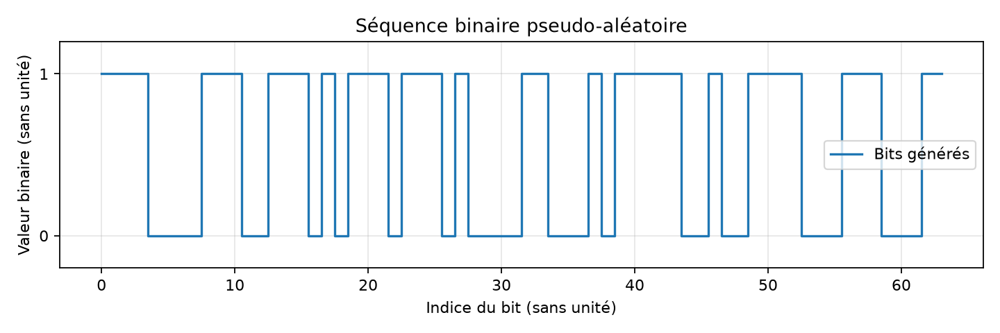

# Expérience 01 — Génération binaire

## A. Objectif
Produire des bits pseudo-aléatoires reproductibles.

## B. Théorie
Un bit représente deux états. PCG64 est déterministe à graine fixée ; il ne constitue pas une source physique ni cryptographique.
Voir aussi [les conventions](../theory/01_modulations.md).

## C. Équations
$b_i\in\{0,1\}$ ; $N$ est le nombre de bits sans unité et $f_1=\sum_i b_i/N$ leur fraction de 1. Le modèle cible $P(b_i=1)=1/2$.

## D. Algorithme
Créer un générateur local, tirer N entiers dans {0,1}, tracer les 64 premiers et exporter la séquence.

## E. Implémentation
generate_bits(count, seed) renvoie un vecteur uint8 et refuse les tailles non entières ou négatives.
Paramètres centralisés dans `configs/fundamentals.json` : 10 000 bits, graine 20261016.

## F. Exécution
Depuis la racine, après installation du package :
```powershell
.\.venv\Scripts\python.exe experiments/01_binary_generation.py
```

## G. Résultats
Mesure : 10 000 bits, 5 000 à 1, fraction 0,5 (coïncidence du tirage).



La figure est enregistrée dans `results/figures/01_binary_generation.png`.
Les données CSV et mesures JSON portent le nom `binary_generation` dans `results/datasets`
et `results/reports`. Le bilan chiffré réellement exécuté se trouve dans PROGRESS.md.

## H. Interprétation
La fraction de 1 observée doit être proche de 1/2 sans être forcée à cette valeur.

## I. Limites
Le test de reproductibilité ne prouve ni indépendance statistique complète ni qualité cryptographique.

## J. Questions d’ingénierie
1. Pourquoi une graine ?
2. Pourquoi ne pas exiger exactement 50 % de 1 ?
3. Un bit est-il un symbole ?

## Réponses
1. Pour répéter exactement une expérience avec la même version du générateur.
2. Les fluctuations font partie du tirage aléatoire.
3. Seulement si la modulation transporte un bit par symbole.
