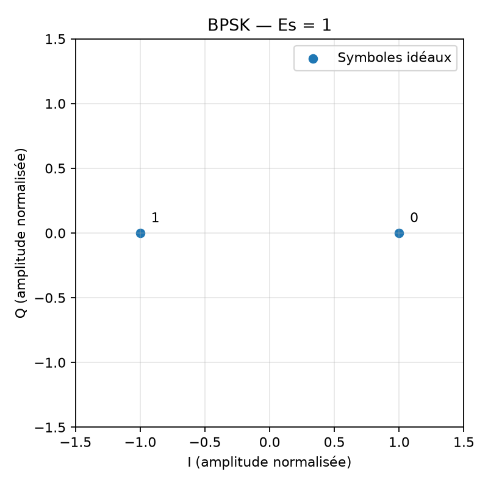

# Expérience 02 — Modulation BPSK

## A. Objectif
Mapper et restituer une séquence sans bruit avec une énergie normalisée.

## B. Théorie
La BPSK utilise deux points opposés sur l’axe réel. Le récepteur cohérent connaît la phase et décide selon le signe de I.
Voir aussi [les conventions](../theory/01_modulations.md).

## C. Équations
$s=1-2b$, $E_s=\mathbb{E}|s|^2=1$, $k=1$, $E_b=E_s$. Le bit $b$ est sans unité ; $s$ est une amplitude normalisée. $\hat b=1$ si $\Re(y)<0$, sinon 0.

## D. Algorithme
Générer les bits, convertir en symboles, décider leur signe, comparer bit par bit et tracer les deux points idéaux.

## E. Implémentation
modulate_bpsk utilise un calcul flottant pour éviter le débordement des uint8 ; demodulate_bpsk décide 0 sur le seuil.
Paramètres centralisés dans `configs/fundamentals.json` : 10 000 bits, graine 20261016.

## F. Exécution
Depuis la racine, après installation du package :
```powershell
.\.venv\Scripts\python.exe experiments/02_bpsk.py
```

## G. Résultats
Mesure : 10 000 bits, 10 000 symboles, 0 erreur, énergie moyenne 1,0.



La figure est enregistrée dans `results/figures/02_bpsk.png`.
Les données CSV et mesures JSON portent le nom `bpsk` dans `results/datasets`
et `results/reports`. Le bilan chiffré réellement exécuté se trouve dans PROGRESS.md.

## H. Interprétation
Une restitution exacte et une énergie 1 valident le mapping sur ce canal idéal.

## I. Limites
Aucun bruit ni défaut de phase ; cette expérience ne mesure pas de BER radio.

## J. Questions d’ingénierie
1. Pourquoi convertir avant la soustraction ?
2. Quelle énergie pour chaque point ?
3. Que provoque une rotation de pi non corrigée ?

## Réponses
1. Pour éviter un calcul entier non signé qui pourrait déborder.
2. Le carré du module vaut 1.
3. Elle inverse toutes les décisions binaires.
