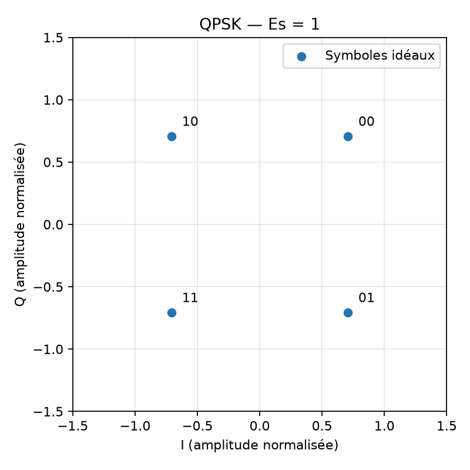

# Expérience 03 — QPSK avec mapping Gray

## A. Objectif
Transporter deux bits par symbole et vérifier le mapping Gray.

## B. Théorie
Quatre points en quadrature représentent les quatre paires binaires. Les voisins circulaires 00, 01, 11, 10 diffèrent chacun d’un seul bit.
Voir aussi [les conventions](../theory/01_modulations.md).

## C. Équations
$s=((1-2b_I)+j(1-2b_Q))/\sqrt{2}$ ; $E_s=1$, $k=2$, $E_b=1/2$. Les bits $b_I,b_Q$ sont sans unité ; I,Q sont des amplitudes normalisées. Chaque composante est décidée par son signe.

## D. Algorithme
Regrouper par paires I puis Q, appliquer le mapping, décider séparément les signes, entrelacer les bits et comparer.

## E. Implémentation
modulate_qpsk refuse les séquences impaires. demodulate_qpsk restitue l’ordre I,Q, sans bourrage caché.
Paramètres centralisés dans `configs/fundamentals.json` : 10 000 bits, graine 20261016.

## F. Exécution
Depuis la racine, après installation du package :
```powershell
.\.venv\Scripts\python.exe experiments/03_qpsk.py
```

## G. Résultats
Mesure : 10 000 bits, 5 000 symboles, 0 erreur, énergie moyenne 1,0.



La figure est enregistrée dans `results/figures/03_qpsk.png`.
Les données CSV et mesures JSON portent le nom `qpsk` dans `results/datasets`
et `results/reports`. Le bilan chiffré réellement exécuté se trouve dans PROGRESS.md.

## H. Interprétation
L’énergie vaut 1 malgré deux composantes ; la restitution doit être exacte et la distance entre voisins vaut sqrt(2).

## I. Limites
Phase et synchronisation supposées parfaites. Une longueur impaire nécessite un protocole de bourrage explicite dans une phase ultérieure.

## J. Questions d’ingénierie
1. Pourquoi diviser par sqrt(2) ?
2. Pourquoi deux bits par symbole ?
3. Gray élimine-t-il les erreurs ?

## Réponses
1. Les deux composantes non normalisées apporteraient une énergie totale 2.
2. Quatre points distincts permettent log2(4)=2 bits.
3. Non ; il limite le nombre de bits changés pour une décision vers un voisin.
