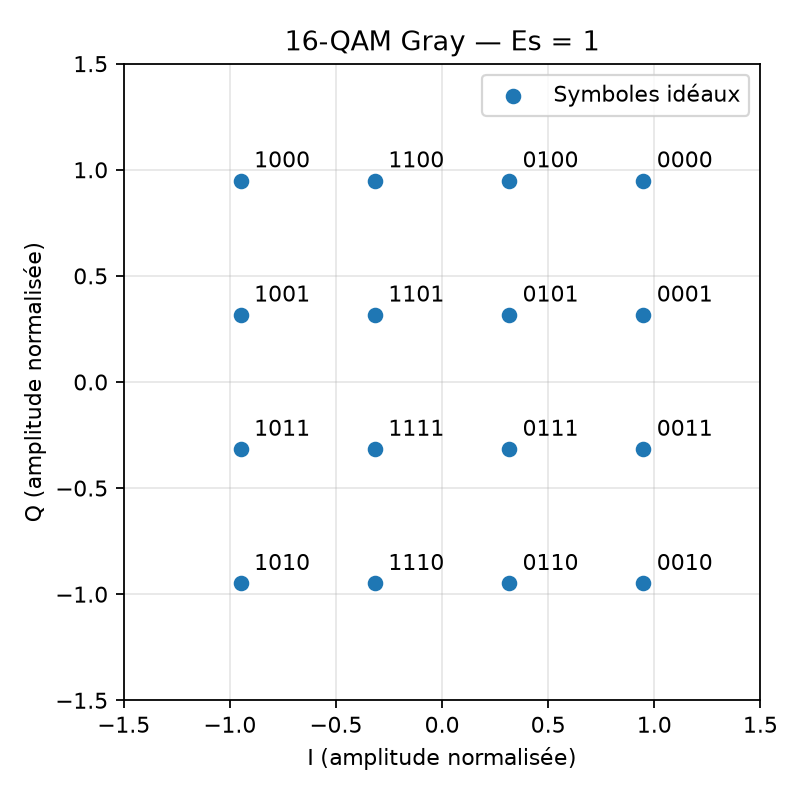
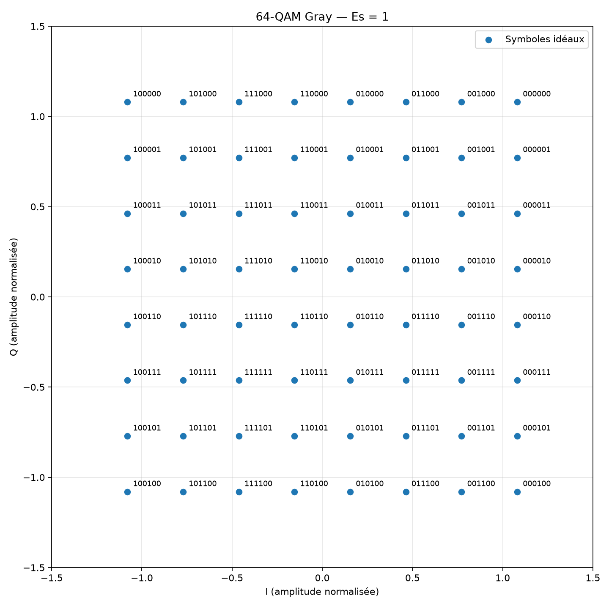

# Expérience 04 — Comparaison 16-QAM et 64-QAM Gray

## A. Objectif
Construire les alphabets QAM, vérifier leur démodulation idéale et comparer débit par
symbole, énergie et distance minimale. Cette expérience termine la phase 1.

## B. Théorie
La modulation d’amplitude en quadrature combine deux axes réels I et Q. Une constellation
carrée possède M=L² points ; elle transporte log₂(M) bits par symbole. Les étiquettes Gray
limitent à un bit la différence entre voisins horizontaux ou verticaux.
Voir [la dérivation détaillée](../theory/02_qam.md).

## C. Équations
Pour l’indice r d’un axe, $a=L-1-2r$, avec $r=0,\ldots,L-1$.

$$s=\frac{a_I+ja_Q}{\sqrt{2(M-1)/3}},\quad E_s=1,\quad E_b=\frac{1}{\log_2 M},\quad
 d_{min}=\sqrt{\frac{6}{M-1}}.$$

M est le nombre de points et L le nombre de niveaux par axe, tous deux sans unité.
I et Q sont des amplitudes normalisées ; aucune énergie physique en joules n’est fixée.
Es=1 est la moyenne sur l’alphabet équiprobable. Les symboles individuels et la moyenne
d’un tirage fini peuvent avoir une énergie différente de 1.

## D. Algorithme
1. Énumérer toutes les étiquettes binaires, poids fort en tête.
2. Séparer chaque groupe en bits I puis bits Q ; convertir Gray en indice binaire.
3. Transformer l’indice en amplitude et normaliser.
4. Générer 120 000 bits, les mapper, puis décider sur les seuils I/Q.
5. Retrouver les étiquettes Gray, compter les erreurs de bits et de symboles.
6. Exporter les alphabets, les mesures et les constellations annotées.

## E. Implémentation
`modulate_qam(bits, order)` accepte 16 ou 64, refuse les entrées non binaires et les
longueurs non divisibles par log₂(M). `demodulate_qam(symbols, order)` utilise les
mi-points des niveaux ; une égalité exacte choisit l’amplitude supérieure. Les valeurs
extérieures à la constellation sont décidées vers un niveau extrême. Aucun bourrage
n’est ajouté implicitement. La configuration est `configs/qam.json`.

Les tests énumèrent tout l’alphabet, contrôlent l’énergie moyenne et chaque voisin Gray,
puis comparent le détecteur à une référence indépendante par distance euclidienne.

## F. Exécution
À la racine, avec le Python du venv :
```powershell
.\.venv\Scripts\python.exe -m pytest -q
.\.venv\Scripts\python.exe experiments/04_qam.py
```
Sous Linux/macOS, remplacer l’exécutable par `.venv/bin/python`.

## G. Résultats
Mesures du 16 octobre 2026, graine 20261016, NumPy 2.5.4, canal idéal et phase connue.

| Modulation | Bits | Symboles | Erreurs bits / symboles | Es alphabet | Es tirage | Distance minimale |
|---|---:|---:|---:|---:|---:|---:|
| 16-QAM | 120 000 | 30 000 | 0 / 0 | 1 | 1,00264 | 0,632456 |
| 64-QAM | 120 000 | 20 000 | 0 / 0 | ≈1 | 1,007333 | 0,308607 |





Mesures exactes : `results/reports/qam.json` et `results/datasets/qam_comparison.csv`.
Les alphabets étiquetés sont dans `16qam_alphabet.csv` et `64qam_alphabet.csv`.
Lors de la lecture CSV, garder `bits_I_puis_Q` comme chaîne pour préserver les zéros initiaux.

## H. Interprétation
Les bits sont exactement reconstruits pour les deux ordres. Les écarts de moyenne
énergétique du tirage sont attendus : le tirage ne contient pas chaque point autant
de fois. La 64-QAM transporte 6 bits au lieu de 4 par symbole mais présente une distance
minimale plus faible à Es constant. Le BER et le SER observés sont nuls sur ce canal idéal.

## I. Limites
Pas de bruit, de canal multitrajet, de mise en forme ni de défaut de synchronisation.
Ces essais ne mesurent pas la robustesse sous bruit. L’efficacité en bit/s/Hz exige un
modèle de bande occupée. Le protocole de bourrage sera défini avec la transmission de trames.
La comparaison à Eb/N0 fixé sera réalisée en phase 2.

## J. Questions d’ingénierie
1. Pourquoi la normalisation est-elle sqrt(10) pour la 16-QAM ?
2. Es=1 impose-t-il une énergie constante à chaque symbole ?
3. Pourquoi ne pas mesurer une efficacité en bit/s/Hz ici ?
4. Pourquoi valider tous les voisins Gray, et pas seulement un aller-retour ?
5. Le BER idéal nul démontre-t-il une absence d’erreurs sous bruit ?

## Réponses
1. Chaque axe a une énergie moyenne (9+1+1+9)/4=5, soit 10 pour les deux axes.
2. Non ; Es est une moyenne sur les points équiprobables. Les points extérieurs sont plus énergétiques.
3. Le débit symbole et la mise en forme spectrale ne sont pas spécifiés.
4. Un mapping erroné peut être exactement inversé par un démappeur tout aussi erroné.
5. Non ; il valide ici la restitution déterministe avec synchronisation idéale.
