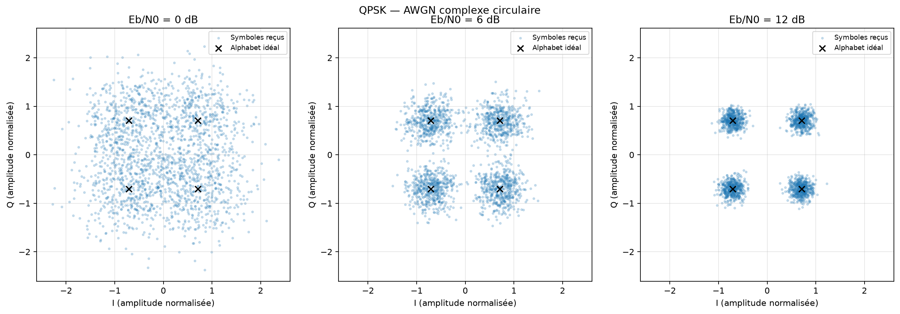
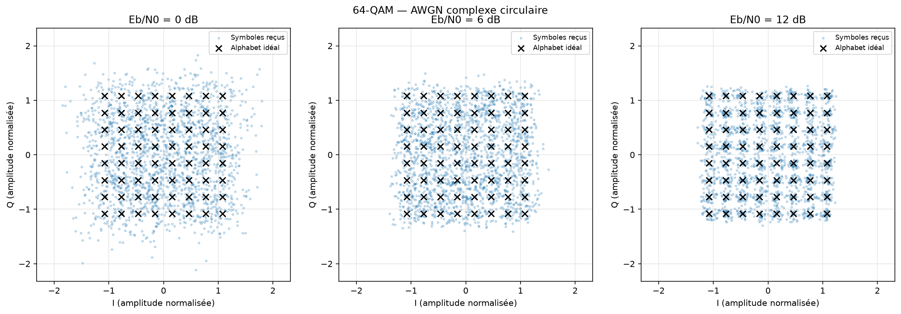

# Expérience 05 — Canal AWGN complexe

## A. Objectif
Vérifier la puissance de bruit imposée et observer la dispersion des quatre constellations.

## B. Théorie
Un bruit additif blanc gaussien idéal représente les perturbations thermiques dans une
chaîne discrète. I et Q sont indépendants, gaussiens et de moyenne nulle. Le récepteur
est supposé synchronisé. Voir [les conventions énergétiques](../theory/03_awgn.md).

## C. Équations
$y=s+n$, $n=\sqrt{N_0/2}(u+jv)$, avec u et v gaussiens standard indépendants.
$N_0=E_s/(k\,10^{(E_b/N_0)_{dB}/10})$. Es=1 est l’énergie normalisée d’alphabet,
k le nombre de bits par symbole, N0 la variance complexe totale. Les amplitudes n’ont
pas de calibration physique. La variance de chaque axe vaut N0/2.

## D. Algorithme
1. Générer 48 000 bits avec une graine fixe.
2. Mapper chaque modulation en gardant son énergie d’alphabet Es=1.
3. Pour Eb/N0 dans {0,6,12} dB, calculer N0 et ajouter le bruit complexe indépendant.
4. Mesurer puissance totale, variances et moyennes I/Q, ainsi que le SNR observé.
5. Tracer 2 000 symboles reçus par cas et exporter toutes les mesures.

## E. Implémentation
`noise_variance` applique le bilan énergétique. `add_awgn` ne renormalise ni le signal
ni le bruit tiré : la puissance mesurée doit pouvoir fluctuer. Un générateur local évite
de modifier l’état global. Chaque cas a une graine de bruit distincte issue de SeedSequence,
enregistrée avec la graine des bits et la version NumPy.
Les entrées non finies, variances négatives et paramètres énergétiques invalides sont refusés.

## F. Exécution
```powershell
.\.venv\Scripts\python.exe -m pytest -q tests/test_noise.py
.\.venv\Scripts\python.exe experiments/05_awgn.py
```
Sous Linux/macOS : `.venv/bin/python`. Paramètres : `configs/awgn.json`.

## G. Résultats
12 cas réellement exécutés, graine principale 20261016, NumPy 2.5.4.
Écart relatif maximal de puissance mesurée par rapport à N0 : 1,225 %.
Exemple QPSK à 6 dB : N0 cible 0,125594, puissance mesurée 0,125462.
Données complètes : `results/datasets/awgn.csv` et `results/reports/awgn.json`.





Des figures BPSK et 16-QAM sont également produites. Les échelles sont identiques entre
les trois panneaux d’une même modulation. Tous les points proviennent de tirages simulés.

## H. Interprétation
Quand Eb/N0 augmente, N0 diminue et les nuages se resserrent. À Eb/N0 fixé et Es=1,
N0 dépend de k : ce n’est pas une comparaison à bruit identique entre modulations.
La puissance moyenne d’un bruit complexe gaussien sur N échantillons a un écart-type
N0/sqrt(N). Les fluctuations observées sont compatibles avec cette dispersion.

## I. Limites
Aucune mesure de BER n’est déduite d’un simple nuage ; les compteurs et intervalles de
confiance sont l’objet de l’expérience 6. Pas de canal sélectif, de codage, de CP ni de
pilotes. Le bruit blanc idéal n’est pas un modèle exhaustif de tous les défauts radio.

## J. Questions d’ingénierie
1. Pourquoi N0/2 par axe ?
2. Pourquoi ne pas imposer exactement la puissance N0 au tirage ?
3. Eb/N0 est-il égal au SNR ?
4. Pourquoi la graine de bruit change-t-elle entre cas ?

## Réponses
1. Les puissances des deux composantes indépendantes s’additionnent pour donner N0.
2. Une renormalisation retire une fluctuation physique du modèle Monte-Carlo.
3. Ici SNR=Es/N0=k Eb/N0 en linéaire ; le suréchantillonnage et les surcoûts changent ce bilan.
4. Pour utiliser des flux distincts et ne pas imposer un même bruit redimensionné aux cas comparés.
