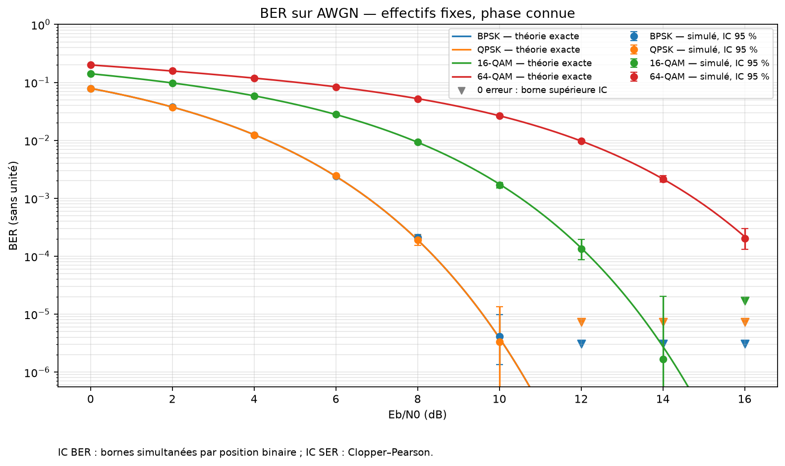
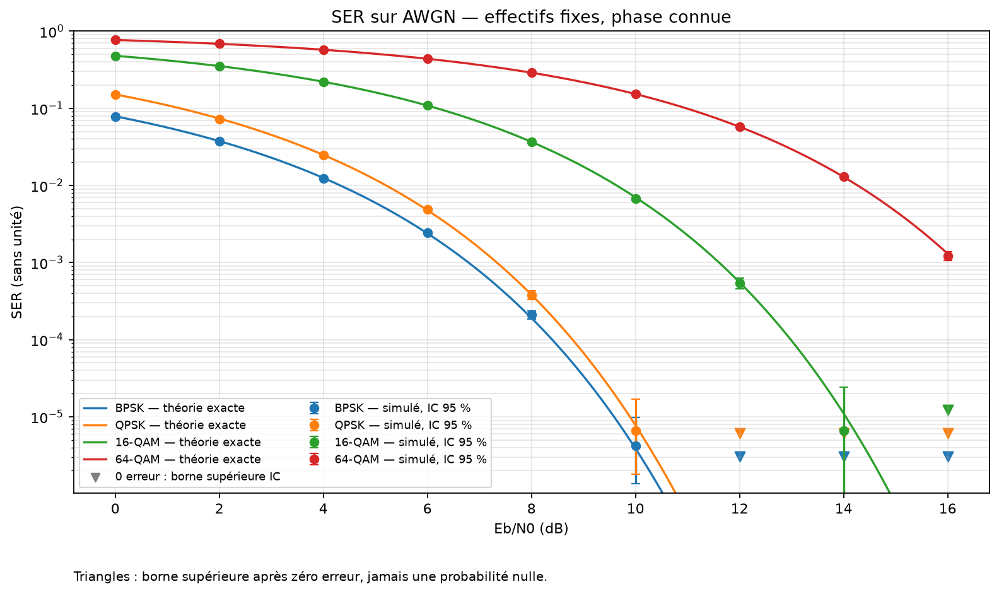
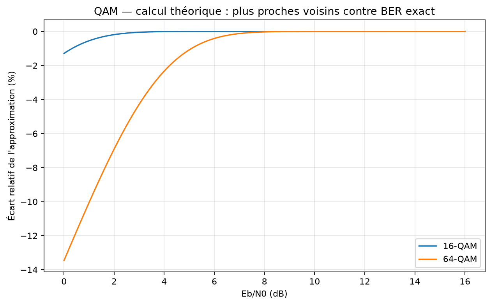

# Expérience 06 — Courbes BER et SER sur AWGN

## A. Objectif
Comparer les quatre modulations à Eb/N0 fixé et confronter les estimations Monte-Carlo
aux références exactes, en affichant les effectifs et l’incertitude de chaque mesure.

## B. Théorie
Le BER est la proportion de bits erronés ; le SER est la proportion de symboles erronés.
Les symboles et le bruit sont indépendants ; la phase et le timing sont connus.
Les énergies, la fonction Q, les références QAM et les intervalles sont dérivés dans
[la note théorique](../theory/04_ber_ser.md). Les formules n’incluent ni codage ni surcoûts.

## C. Équations
$\widehat P_b=E_b^{err}/N_b$, $\widehat P_s=E_s^{err}/N_s$, $N_b=kN_s$.
Les E exposant err sont des compteurs, les N des nombres d’essais et k=log₂(M) des bits
par symbole. Les proportions sont sans unité ; Eb/N0 est en dB.
BPSK/QPSK Gray : $P_b=Q(\sqrt{2\gamma_b})$, avec γb le rapport Eb/N0 linéaire.
Le BER QAM exact est une somme des probabilités de transitions gaussiennes pondérées
par la distance de Hamming. Sa formule approximative de plus proches voisins est conservée
dans une colonne distincte et n’est pas utilisée comme référence exacte.

## D. Algorithme
1. Fixer **1 200 000 bits par point**, avant tout tirage, et la grille 0,2,…,16 dB.
2. Créer des graines indépendantes par point puis des flux séparés pour bits et bruit.
3. Simuler par blocs de 20 000 symboles sans arrêt adaptatif sur le nombre d’erreurs.
4. Accumuler erreurs par bit, par symbole et par position binaire.
5. Calculer IC ponctuels 95 %, puis enveloppe simultanée de validation 99 %.
6. Calculer séparément les courbes théoriques denses et tracer les points mesurés avec leurs IC.
7. Enregistrer CSV, JSON, drapeaux de faible effectif d’erreurs et paramètres.

## E. Implémentation
`simulate_awgn` est réutilisable et limite la mémoire grâce aux blocs. `count_errors` compte
une erreur de symbole même si plusieurs bits sont faux. `binomial_interval` donne les bornes
Clopper–Pearson exactes pour des essais indépendants. `ber_interval` combine les bornes par
position avec Bonferroni : la dépendance entre bits QAM d’un même symbole est respectée.
`ber_awgn` intègre chaque région de décision QAM, alors que `qam_ber_nearest_neighbor`
calcule une approximation explicitement nommée.

La configuration et la taille des blocs font partie de la reproductibilité. Modifier la taille
de blocs peut modifier le tirage ; aucune invariance des échantillons au découpage n’est promise.

## F. Exécution
```powershell
.\.venv\Scripts\python.exe -m pytest -q
.\.venv\Scripts\python.exe experiments/06_ber_comparison.py
```
Sous Linux/macOS : `.venv/bin/python`. Paramètres : `configs/ber.json`.

## G. Résultats
Exécution du 16 octobre 2026, graine principale 20261016, NumPy 2.5.4.
36 points et 43 200 000 bits. Extrait à Eb/N0=6 dB, **1 200 000 bits par ligne** :

| Modulation | Symboles | Erreurs binaires | BER mesuré | BER exact |
|---|---:|---:|---:|---:|
| BPSK | 1 200 000 | 2 907 | 0,0024225 | 0,002388291 |
| QPSK | 600 000 | 2 962 | 0,00246833 | 0,002388291 |
| 16-QAM | 300 000 | 33 808 | 0,0281733 | 0,02787133 |
| 64-QAM | 200 000 | 100 317 | 0,0835975 | 0,08381678 |

36/36 références BER et 33/36 références SER sont dans les IC ponctuels 95 %.
Toutes sont dans l’enveloppe simultanée de validation au niveau au moins 99 %.
Sept points ont zéro erreur binaire ; leurs bornes restent strictement positives.
Les points avec moins de 100 erreurs binaires sont signalés dans les exports.







À 0 dB, l’approximation sous-estime le BER exact de 1,29 % en 16-QAM et 13,46 % en 64-QAM.
Cette troisième figure est **un calcul théorique**, pas une mesure Monte-Carlo.
Mesures et IC exacts : `results/datasets/ber_comparison.csv`, `results/reports/ber_comparison.json`.
La colonne CSV `errors_per_bit_position` est un tableau JSON. Références : `awgn_theory.csv`.
Synthèse : `results/reports/ber_summary.json`.

## H. Interprétation
BPSK et QPSK suivent le même BER à Eb/N0 égal. Les QAM transportent davantage de bits par
symbole mais demandent un rapport plus élevé pour un même BER dans ce modèle.
Un IC 95 % n’est pas une garantie de présence de la référence pour chaque tirage :
quelques exclusions sont compatibles avec le risque annoncé, surtout sur 36 points.
L’enveloppe multiple donne un critère global distinct et vérifiable.

## I. Limites
À haut Eb/N0, l’effectif fixe ne suffit plus pour estimer précisément les probabilités rares.
Zéro erreur ne démontre pas une probabilité nulle. La largeur des IC en témoigne.
Les intervalles reposent sur des symboles indépendants ; ils ne couvrent pas automatiquement
un canal à mémoire ou des trames corrélées. Les modèles excluent codage, CP, pilotes,
filtrage réel, quantification et défauts de synchronisation.

## J. Questions d’ingénierie
1. Pourquoi fixer l’effectif avant la simulation ?
2. Pourquoi ne pas traiter tous les bits QAM comme des essais Bernoulli indépendants ?
3. Quelle signification donner à zéro erreur ?
4. Pourquoi comparer aussi les SER ?
5. Une référence hors d’un IC ponctuel 95 % impose-t-elle d’invalider tout le modèle ?

## Réponses
1. Un arrêt conditionné par le nombre d’erreurs change la loi et peut invalider l’IC binomial fixe.
2. Un déplacement géométrique peut changer plusieurs bits du même symbole, rendant les erreurs dépendantes.
3. C’est une observation finie, accompagnée d’une borne ; pas une preuve de probabilité nulle.
4. Le SER valide la géométrie des décisions indépendamment du nombre de bits changés par symbole.
5. Non ; il faut analyser l’ampleur, les comparaisons multiples et les tests statistiques appropriés.
