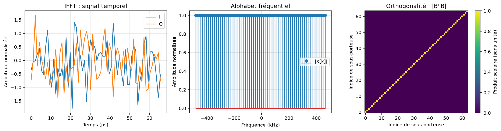

# Expérience 07 — FFT et IFFT

## A. Objectif
Vérifier l’inversion, la conservation d’énergie et l’orthogonalité des sous-porteuses.
## B. Théorie
Une DFT décompose un signal sur des exponentielles orthogonales ; FFT et IFFT réalisent
les transformations directe et inverse. Voir [les conventions](../theory/05_fft_ofdm.md).
## C. Équations
FFT(IFFT(X))=X à l’arrondi près ; BᴴB=I ; somme|x|²=somme|X|².
N=64 points, Δf=15 000 Hz, Fs=N Δf=960 000 échantillons/s, Tu=66,667 µs.
Les amplitudes sont normalisées et les indices n,k sont sans unité.
## D. Algorithme
Générer 64 symboles QPSK, appliquer IFFT puis FFT et mesurer l’erreur maximale.
Construire séparément la base exponentielle et sa matrice de Gram.
## E. Implémentation
`transforms.fft` et `ifft` sont unitaires, sur le dernier axe, sans bourrage ni troncature.
`subcarrier_frequencies` fournit les fréquences en ordre natif. Les entrées vides/non finies sont refusées.
## F. Exécution
```powershell
.\.venv\Scripts\python.exe experiments/07_fft_ifft.py
```
Configuration : configs/fft.json. Sous Linux/macOS : .venv/bin/python.
## G. Résultats
Les valeurs effectivement calculées sont dans results/reports/fft.json ; les signaux dans
fft_time.csv et fft_frequency.csv. Les erreurs sont d’ordre machine, pas strictement nulles.

## H. Interprétation
L’inversion valide la paire de transformations ; le contrôle matriciel vérifie indépendamment
le signe et la normalisation. Parseval prépare le bilan énergétique OFDM.
## I. Limites
Pas de CP, de bruit ou de désynchronisation dans cette expérience. Une orthogonalité numérique
sur la fenêtre utile ne démontre pas une immunité aux canaux radio réels.
## J. Questions d’ingénierie
1. FFT et DFT sont-elles deux transformations différentes ?
2. Pourquoi choisir une normalisation unitaire ?
3. Où est DC dans l’ordre natif ?
## Réponses
1. Non : FFT est un algorithme de calcul de la DFT.
2. Pour conserver directement l’énergie et la variance d’un bruit blanc.
3. À l’indice 0 ; les figures peuvent recentrer DC avec fftshift.
