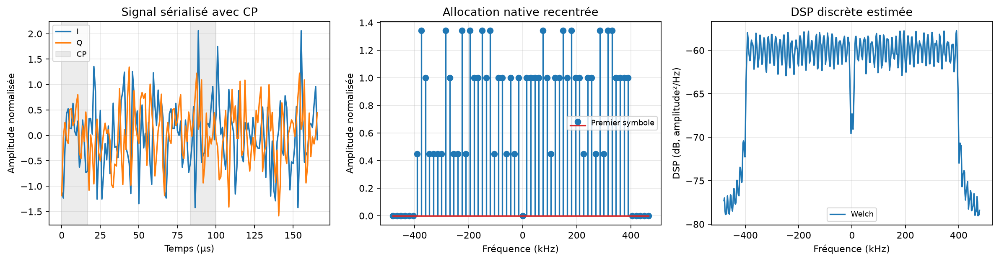

# Expérience 08 — Émetteur OFDM

## A. Objectif
Construire le vrai signal OFDM et contrôler son allocation et son énergie.
## B. Théorie
Sous-porteuses orthogonales sur la fenêtre utile, bande de base complexe et phase connue.
Voir [les conventions et le bilan](../theory/05_fft_ofdm.md).
## C. Équations
N=64, K=52, C=16, 16-QAM, Fs=960 000 échantillons/s ; Eu attendu=52 et Et attendu=65 unités normalisées.
N, K et C sont des nombres sans unité ; k est le nombre de bits par symbole de modulation.
Δf est en Hz, Fs en échantillons/s et le temps en secondes.
## D. Algorithme
Bits → mapping existant → allocation native → IFFT unitaire → copie cyclique → flux 1D.
## E. Implémentation
OFDMConfig valide les paramètres. transmit et receive utilisent les mappings existants,
sans bibliothèque externe de chaîne OFDM. Les blocs incomplets sont refusés.
La DSP de Welch emploie une fenêtre Hann de 512 échantillons, recouvrement de moitié, sans retrait de moyenne. Les dB sont référencés à une unité normalisée²/Hz. Les CSV temporels montrent deux symboles ; le reste est reproductible par la graine.
## F. Exécution
```powershell
.\.venv\Scripts\python.exe experiments/08_ofdm_transmitter.py
```
Configuration : configs/ofdm.json. Sous Linux/macOS : .venv/bin/python.
## G. Résultats
256 symboles OFDM, 53 248 bits, 20 480 échantillons. Eu mesuré=52,25625 et Et mesuré=65,67047 en moyenne par symbole OFDM.
Mesures complètes dans results/reports/ofdm_transmitter.json, données dans results/datasets/ofdm*.csv.

## H. Interprétation
Les écarts des moyennes mesurées sont dus au tirage fini ; aucune correction artificielle ne les annule.
## I. Limites
Début de flux et configuration connus, sans estimation, CFO, codage, pilotes ou multitrajet.
La DSP estimée d’une séquence discrète finie ne simule pas une émission RF physique.
## J. Questions d’ingénierie
1. Pourquoi ne pas utiliser fftshift dans l’allocation native ?
2. Pourquoi le CP coûte-t-il de l’énergie sans améliorer le BER AWGN ?
3. Pourquoi refuser les blocs incomplets ?
## Réponses
1. Il change l’ordre des cases ; le mapping et le récepteur doivent partager l’ordre natif.
2. Il répète de l’information et est retiré avant décision ; son intérêt concerne les trajets multiples.
3. Un bourrage exige des métadonnées explicites, qui seront définies avec les trames de phase 6.
