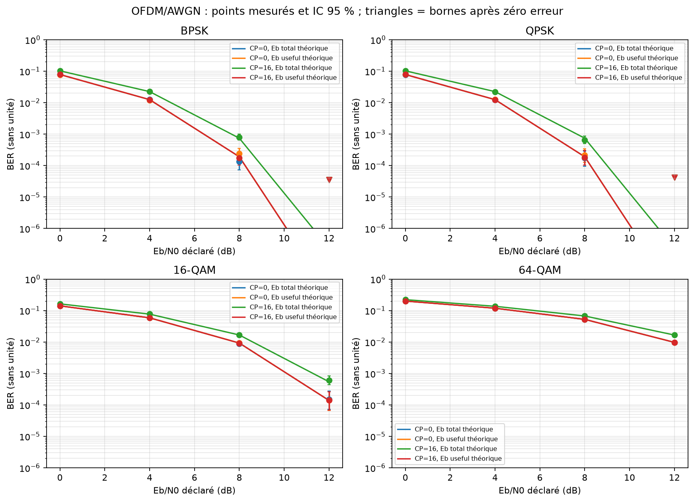

# Expérience 09 — Récepteur OFDM idéal et AWGN

## A. Objectif
Valider les bits récupérés et le bilan Eb/N0 en présence de CP.
## B. Théorie
Sous-porteuses orthogonales sur la fenêtre utile, bande de base complexe et phase connue.
Voir [les conventions et le bilan](../theory/05_fft_ofdm.md).
## C. Équations
N0=1/(k γb) en référence useful ; N0=(1+C/N)/(k γb) en référence total. Le SER compte les symboles BPSK/QPSK/QAM, pas les blocs OFDM.
N, K et C sont des nombres sans unité ; k est le nombre de bits par symbole de modulation.
Δf est en Hz, Fs en échantillons/s et le temps en secondes.
## D. Algorithme
Générer des trames complètes, ajouter le bruit calibré, retirer le CP, FFT, extraire les porteuses et démoduler. Compter BER/SER avec les modules existants.
## E. Implémentation
OFDMConfig valide les paramètres. transmit et receive utilisent les mappings existants,
sans bibliothèque externe de chaîne OFDM. Les blocs incomplets sont refusés.
Effectif fixé à 2 000 symboles OFDM par point. Les IC BER sont corrigés par position binaire QAM ; les symboles de modulation restent indépendants après FFT du bruit blanc. La validation globale répartit le risque 1 % sur 128 comparaisons. Le CP ne protège pas contre un canal multitrajet encore absent.
## F. Exécution
```powershell
.\.venv\Scripts\python.exe experiments/09_ofdm_awgn.py
```
Configuration : configs/ofdm_awgn.json. Sous Linux/macOS : .venv/bin/python.
## G. Résultats
64 points, 21 632 000 bits ; quatre modulations, CP 0 ou 16, deux références énergétiques et Eb/N0=0,4,8,12 dB. Huit essais idéaux ont zéro erreur. Tous les BER et SER passent l’enveloppe simultanée au moins 99 %.
Mesures complètes dans results/reports/ofdm_summary.json et ofdm_awgn.json, données dans results/datasets/ofdm*.csv.

## H. Interprétation
Le CP ne modifie pas la référence théorique utile sur AWGN. En référence totale, C/N=16/64 impose une pénalité de 0,969100 dB. Des bornes sont conservées lorsque zéro erreur est observé.
## I. Limites
Début de flux et configuration connus, sans estimation, CFO, codage, pilotes ou multitrajet.
La DSP estimée d’une séquence discrète finie ne simule pas une émission RF physique.
## J. Questions d’ingénierie
1. Pourquoi ne pas utiliser fftshift dans l’allocation native ?
2. Pourquoi le CP coûte-t-il de l’énergie sans améliorer le BER AWGN ?
3. Pourquoi refuser les blocs incomplets ?
## Réponses
1. Il change l’ordre des cases ; le mapping et le récepteur doivent partager l’ordre natif.
2. Il répète de l’information et est retiré avant décision ; son intérêt concerne les trajets multiples.
3. Un bourrage exige des métadonnées explicites, qui seront définies avec les trames de phase 6.
