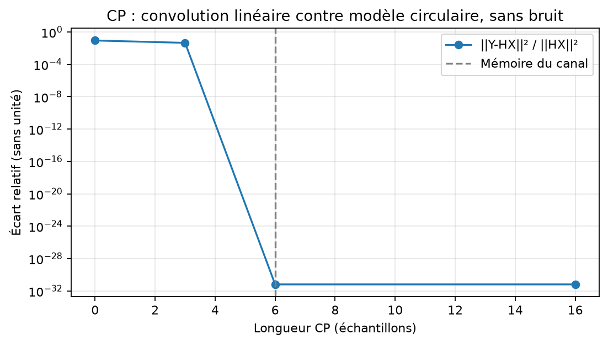

# Expérience 10 — Rôle du CP

## A. Objectif
Comparer convolution linéaire et modèle circulaire sur un flux OFDM complet.
## B. Théorie
Un canal multitrajet applique une convolution causale. Voir [le modèle et les conventions](../theory/06_multipath.md).
## C. Équations
Y=FFT_unitaire(y utile), H=FFT_non_normalisée(h), cible=H X. L’écart est ||Y−HX||²/||HX||², sans unité. La mémoire D=6 échantillons et C est la longueur CP.
## D. Algorithme
Générer les mêmes bits pour C=0,3,6,16 ; transmettre le flux entier par convolution ; retirer le CP ; comparer à H X. Compter aussi les erreurs sans égalisation, uniquement descriptives.
## E. Implémentation
channels.apply_multipath conserve la convolution complète. frequency_response refuse une troncature
implicite de h. rayleigh_channel normalise le profil moyen, jamais une réalisation.
Configuration : configs/multipath.json. Les graines et versions sont enregistrées.
## F. Exécution
```powershell
.\.venv\Scripts\python.exe experiments/10_cyclic_prefix.py
```
Sous Linux/macOS : .venv/bin/python.
## G. Résultats
208 000 bits par cas. Écarts relatifs : 0,0892963 (C=0), 0,0457004 (C=3), 6,32e-32 (C=6 et 16). BER non corrigé proche de 0,26, même avec CP suffisant.
Données : results/datasets ; mesures JSON : results/reports/cyclic_prefix.json et multipath.json.

## H. Interprétation
Le CP suffisant restaure la diagonalisation à l’arrondi près ; il ne corrige pas les gains du canal. Les valeurs très faibles sont des résidus numériques, pas une mesure d’erreur radio nulle.
## I. Limites
Un CP court laisse des erreurs corrélées : aucun IC binomial ni modèle AWGN diagonal n’est appliqué à ces mesures. La première trame suit un état initial nul ; la queue est explicitement exclue du burst reçu.
Aucun canal estimé ni synchronisation imparfaite. L’égalisation sera validée dans l’expérience 12.
## J. Questions d’ingénierie
1. Pourquoi convoluer le flux complet ?
2. Quelle longueur de CP suffit dans ce modèle ?
3. Pourquoi ne pas forcer chaque réalisation Rayleigh à une énergie 1 ?
## Réponses
1. Pour préserver l’interférence physique entre deux symboles successifs.
2. C doit couvrir le dernier retard non nul D, avec début de burst et configuration connus.
3. Cela modifierait la distribution d’évanouissement en supprimant ses fluctuations d’énergie.
