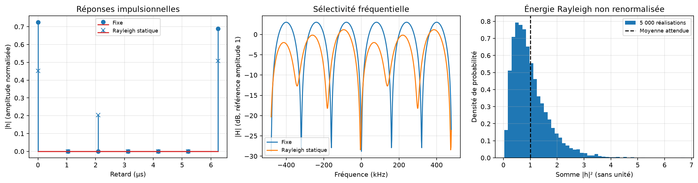

# Expérience 11 — Canaux fixe et Rayleigh

## A. Objectif
Visualiser les réponses du canal et vérifier la puissance moyenne d’un ensemble Rayleigh.
## B. Théorie
Un canal multitrajet applique une convolution causale. Voir [le modèle et les conventions](../theory/06_multipath.md).
## C. Équations
H[k]=somme_l h[l] exp(−j2πkl/N). E somme|h|²=1 pour le profil Rayleigh normalisé. Les retards sont en échantillons puis en µs via Fs=960 kHz ; les amplitudes sont normalisées.
## D. Algorithme
Construire le canal fixe, tirer une réalisation Rayleigh statique et 5 000 réalisations indépendantes. Tracer |h|, |H| et l’histogramme d’énergie ; exporter les coefficients et énergies.
## E. Implémentation
channels.apply_multipath conserve la convolution complète. frequency_response refuse une troncature
implicite de h. rayleigh_channel normalise le profil moyen, jamais une réalisation.
Configuration : configs/multipath.json. Les graines et versions sont enregistrées.
## F. Exécution
```powershell
.\.venv\Scripts\python.exe experiments/11_multipath_channel.py
```
Sous Linux/macOS : .venv/bin/python.
## G. Résultats
Sur 5 000 réalisations, énergie moyenne 1,0044923 et écart-type 0,6773086. La réalisation statique illustrée a une énergie 0,5045701, non renormalisée. Le canal fixe a une énergie 1 et une mémoire 6.
Données : results/datasets ; mesures JSON : results/reports/cyclic_prefix.json et multipath.json.

## H. Interprétation
La moyenne d’ensemble est proche de 1 tandis que les tirages fluctuent fortement, comme attendu. Une réalisation unique n’est pas une moyenne de performances Rayleigh.
## I. Limites
Le canal est statique, sans Doppler. La courbe fréquentielle dense de 512 points est un échantillonnage de la réponse FIR, distinct des 64 cases de données OFDM.
Aucun canal estimé ni synchronisation imparfaite. L’égalisation sera validée dans l’expérience 12.
## J. Questions d’ingénierie
1. Pourquoi convoluer le flux complet ?
2. Quelle longueur de CP suffit dans ce modèle ?
3. Pourquoi ne pas forcer chaque réalisation Rayleigh à une énergie 1 ?
## Réponses
1. Pour préserver l’interférence physique entre deux symboles successifs.
2. C doit couvrir le dernier retard non nul D, avec début de burst et configuration connus.
3. Cela modifierait la distribution d’évanouissement en supprimant ses fluctuations d’énergie.
