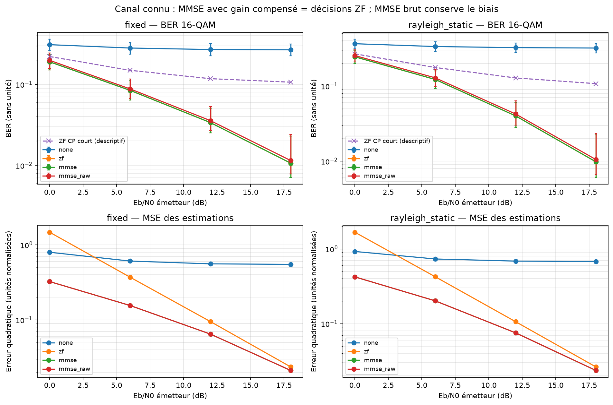

# Expérience 12 — Égalisation ZF et MMSE avec canal connu

## A. Objectif
Comparer bruit amplifié, MSE et BER avant/après égalisation, puis isoler l’effet du biais MMSE.
## B. Théorie
ZF inverse H, MMSE minimise la MSE linéaire avec régularisation N0/Es. Le gain résiduel MMSE
modifie les seuils de décision. Voir [la dérivation et les hypothèses](../theory/07_equalization.md).
## C. Équations
A_ZF=1/H ; A_MMSE=H*/(|H|²+N0/Es) ; gain G=A H.
MSE=Es|AH−1|²+N0|A|² ; le BER conditionnel moyen est la moyenne sur les K porteuses.
H et A sont des gains sans unité, Es et N0 des énergies normalisées, Eb/N0 en dB.
## D. Algorithme
Pour deux canaux statiques, quatre modulations, CP 0/16 et Eb/N0=0,6,12,18 dB :
transmettre 1 000 symboles OFDM puis réutiliser les mêmes observations pour quatre
modes : sans correction, ZF, MMSE avec gain pris en compte, MMSE à seuils bruts.
Compter erreurs et MSE ; calculer les IC par strate seulement pour CP suffisant.
Vérifier les références conditionnelles dans une enveloppe globale de validation 99 %.
Des essais sans bruit, séparés, valident l’inversion avec canal connu avant toute estimation.
## E. Implémentation
equalization.equalize expose estimation, poids, gain, variance de bruit et effacements.
receiver.receive conserve les symboles bruts et retourne aussi les estimations égalisées.
Les décisions par défaut prennent le gain en compte. Le pipeline refuse un creux actif
non inversible lorsqu’il compare ZF. Les singularités MMSE sont traitées explicitement.
simulate_known_channel applique la convolution au flux complet puis ajoute l’AWGN.
Les IC stratifiés réutilisent les fonctions de métriques ; le bruit est référencé à l’émetteur.
## F. Exécution
```powershell
.\.venv\Scripts\python.exe experiments/12_channel_equalization.py
```
Configurations : configs/equalization.json et multipath.json. Sous Linux/macOS : .venv/bin/python.
## G. Résultats
64 essais bruités, 10 816 000 bits transmis distincts, quatre traitements appariés :
256 mesures et 43 264 000 décisions binaires. Les essais idéaux sont comptés séparément.
Les 128 comparaisons conditionnelles BER/SER passent l’enveloppe au moins 99 %.
Tous les essais sans bruit, à CP suffisant et avec égalisation, sont sans erreur.
ZF et MMSE à gain pris en compte ont les mêmes comptes d’erreurs dans les 64 essais.

Extrait 16-QAM, CP=16, Eb/N0=12 dB, **208 000 bits par ligne** :

| Canal | Mode | Erreurs | BER | MSE mesurée |
|---|---|---:|---:|---:|
| Fixe | Sans correction | 56 079 | 0,269611 | 0,558795 |
| Fixe | ZF | 7 027 | 0,033784 | 0,095003 |
| Fixe | MMSE adapté | 7 027 | 0,033784 | 0,064693 |
| Fixe | MMSE seuils bruts | 7 431 | 0,035726 | 0,064693 |
| Rayleigh statique | Sans correction | 67 456 | 0,324308 | 0,686394 |
| Rayleigh statique | ZF | 8 335 | 0,040072 | 0,106225 |
| Rayleigh statique | MMSE adapté | 8 335 | 0,040072 | 0,075319 |


Les points avec CP suffisant ont des IC BER conditionnels conservateurs à 95 % ; les triangles
éventuels représentent une borne haute après zéro erreur. Le CP court est descriptif, sans IC.
Données : equalization.csv, equalization.json et equalization_summary.json dans results/.
Les colonnes de compteurs par porteuse/bit et de coefficients sont des tableaux JSON dans le CSV.
## H. Interprétation
L’égalisation corrige fortement le canal, mais les creux limitent encore le BER. Le MMSE réduit
la MSE d’estimation. Il ne crée pas ici un gain BER face à ZF avec un détecteur scalaire adapté.
Les seuils bruts montrent pourquoi la réduction de MSE seule ne garantit pas un meilleur BER.
La réalisation Rayleigh illustrée a une énergie 0,50457 : sa performance est conditionnelle,
ni une moyenne d’ensemble ni une comparaison à même puissance reçue.
## I. Limites
Canal connu parfaitement, statique, sans Doppler, codage, pilotes ni défaut de synchronisation.
La présence d’ISI avec CP court invalide les modèles diagonaux et leurs IC, pas le comptage brut.
Les IC supposent des trames indépendantes à canal fixé lorsque le CP suffit. Aucune qualité
d’estimation de canal n’est revendiquée avant la phase 5. Les IC stratifiés peuvent être larges.
## J. Questions d’ingénierie
1. Pourquoi ZF amplifie-t-il le bruit dans un creux ?
2. MMSE et ZF peuvent-ils avoir le même BER et des MSE différentes ?
3. Pourquoi ne pas appliquer un IC binomial à toutes les erreurs agrégées ?
4. Pourquoi le CP court conserve-t-il un plancher d’erreurs ?
## Réponses
1. La puissance de bruit est multipliée par 1/|H|².
2. Oui : la mise à l’échelle positive du MMSE change la MSE mais pas les décisions si les seuils suivent le gain.
3. Les probabilités diffèrent entre porteuses ; les positions d’un même symbole peuvent aussi être corrélées.
4. Il reste de l’ISI/ICI ; une simple multiplication diagonale par porteuse ne l’inverse pas.
