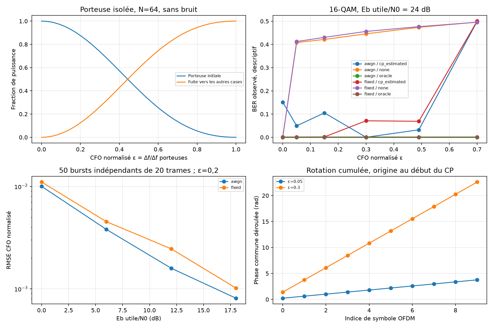

# Expérience 13 — Décalage fréquentiel et première correction

## A. Objectif
Mesurer fuite spectrale, rotation et BER ; comparer absence de correction, estimateur
CP et correction oracle. Étudier la RMSE et exposer les limites de capture et de durée.

## B. Hypothèses
Début exact connu ; CFO constant après FIR, bruit AWGN circulaire ; CP16, N64, K52,
Δf_porteuses=15 kHz. Canal AWGN unitaire ou FIR fixe de mémoire 6 de la phase 4.
H parfaitement connu pour ZF et mémoire connue pour exclure le CP contaminé.

## C. Théorie
Voir [CFO et corrélation CP](../theory/08_synchronization.md). Estimation modulo 1,
correction sur le flux entier. Fuite isolée distincte du BER d’un système chargé.

## D. Paramètres
configs/synchronization.json : graine 20261016, QPSK et 16-QAM, ε=0/0,05/0,15/0,3/0,49/0,7,
Eb utile/N0=12 et 24 dB, 500 symboles OFDM par burst. CP compris dans le flux mais
énergie CP exclue de la référence Eb utile. Es alphabet=1, aucune renormalisation reçue.
50 essais indépendants de 20 symboles par canal et Eb/N0=0/6/12/18 dB, ε=0,2,
servent à la RMSE. SeedSequence sépare données et bruit, itération déterministe.

## E. Implémentation
synchronization.py expose injection CFO avec origine explicite, estimation CP et réponse
d’une porteuse. Corrélation sur les 16 paires CP en AWGN ou les 10 dernières en multitrajet.
La correction est commune aux 500 trames. Expérience 13 ; exports dans results/.

## F. Validation
Tests analytiques de somme géométrique, conservation d’énergie, continuité de phase entre
morceaux, FFT matricielle indépendante et inversion. Estimation exacte sans bruit pour
plusieurs CFO et canaux ; restitution binaire pour les quatre modulations. L’expérience
valide aussi 12 cas sans bruit QPSK/16-QAM et deux canaux. Entrées invalides rejetées.

## G. Résultats exécutés
48 bursts bruités, **3 744 000 bits distincts**, trois modes appariés, 144 mesures BER.
400 bursts supplémentaires pour la RMSE. 12 cas sans bruit corrigés sans erreur.

16-QAM, Eb utile/N0=24 dB, ε=0,15, **104 000 bits par ligne** :

| Canal | Correction | Erreurs | BER |
|---|---|---:|---:|
| AWGN | Aucune | 43 826 | 0,421404 |
| AWGN | CP estimé | 10 928 | 0,105077 |
| AWGN | Oracle | 0 | 0 observé |
| FIR fixe | Aucune | 44 762 | 0,430404 |
| FIR fixe | CP estimé | 171 | 0,001644 |
| FIR fixe | Oracle | 121 | 0,001163 |

La RMSE CFO AWGN passe de 0,010015 à 0,000810 entre 0 et 18 dB ; FIR fixe de
0,011040 à 0,001017. Ce sont des mesures sur 50 essais, sans garantie de monotonie générale.
À ε=0,7, l’estimateur retourne environ -0,3 ; la correction échoue par ambiguïté entière.

Exports : frequency_offset.csv, cfo_estimates.csv, cfo_estimation_summary.csv,
cfo_leakage.csv, frequency_offset.json. Les zéros observés ne prouvent pas un BER nul.

## H. Interprétation
Le CFO non corrigé accumule la phase et projette l’énergie sur d’autres cases FFT.
La correction CP réduit souvent le BER ; le résidu accumulé sur 500 trames explique
l’écart à l’oracle et les irrégularités entre points. Même ε=0 peut être dégradé par
une estimation bruitée. Un essai FIR mieux corrigé qu’un essai AWGN n’établit pas une
supériorité du canal FIR : les erreurs d’estimation changent entre les bursts.

## I. Limites
Pas de timing aveugle, suivi de phase, CFO entier, dérive temporelle, Doppler ni estimation H.
BER descriptifs sans IC binomial. Les essais RMSE et BER ont des durées différentes.
La phase 5 reste en cours : pilotes, interpolation et comparaison globale à réaliser.

## J. Questions d’ingénierie et réponses
1. Pourquoi la phase est-elle continue ? L’oscillateur ne redémarre pas à chaque trame.
2. Pourquoi ε=0,7 échoue-t-il ? La corrélation CP voit une phase modulo 2π.
3. CP=mémoire suffit-il ? Pour l’égalisation oui ; pour cet estimateur aucune paire ne reste.
4. Pourquoi faible RMSE et BER élevé ? La phase résiduelle croît avec la durée du burst.
