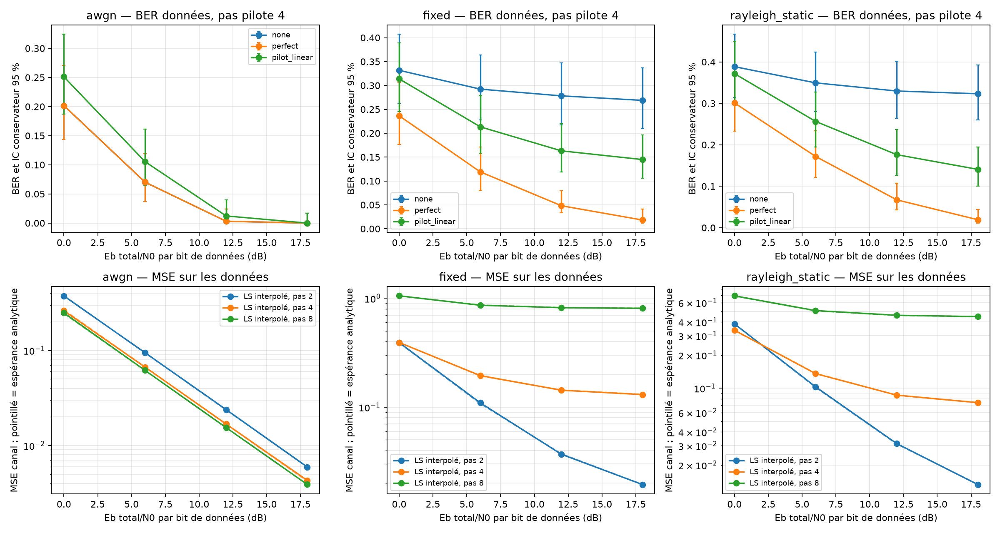

# Expérience 14 — Pilotes et estimation du canal

## A. Objectif
Comparer canal non corrigé, canal parfaitement connu et canal estimé par pilotes ;
mesurer le BER utile, la MSE d’estimation et le compromis densité/énergie/débit.

## B. Théorie
[LS, interpolation et énergie](../theory/09_channel_estimation.md). LS Yp/Xp puis
interpolation complexe linéaire par demi-bande. MSE = biais² + bruit interpolé.

## C. Hypothèses
N64, K52, CP16, timing parfait, CFO nul. AWGN unitaire, FIR fixe mémoire 6 et une
réalisation Rayleigh statique documentée en phase 4. Canal constant, estimation indépendante
par trame. H réel sert aux témoins et mesures uniquement ; LS n’y accède pas.

## D. Paramètres
configs/estimation.json : graine 20261016, QPSK/16-QAM, pas pilotes 2/4/8,
Eb total/N0=0/6/12/18 dB, 500 trames par essai, trois canaux.
Pas 2 : 28 pilotes/24 données ; pas 4 : 16/36 ; pas 8 : 10/42.
Référence Eb par bit de données incluant pilotes et CP. Énergie CP des pilotes
calculée exactement ; Es=1, ni renormalisation du canal ni puissance reçue imposée.
Les graines d’essais sont dérivées de SeedSequence, données et bruit séparés.

## E. Implémentation
estimation.py : plan, émission, LS/interpolation, réception utile et bilan énergétique.
pilot_simulation.py compare les trois modes sur exactement les mêmes bits et bruit.
L’estimateur n’utilise que la grille reçue et les pilotes publics. ZF corrige chaque
trame avec H vrai ou H_hat ; les pilotes sont exclus du comptage d’erreurs.

## F. Validation
Restitution sans bruit sur canal plat pour quatre modulations et trois densités.
Canal FIR connu restitué sans erreur ; biais d’interpolation vérifié indépendamment.
Sommes des poids, séparation des bandes, gardes, compteurs, entrées invalides et répétabilité.
Énergie totale simulée comparée à son espérance, y compris CP pilote déterministe.
Bruit interpolé comparé à sa covariance analytique. Expérience : 72 moyennes MSE
compatibles avec l’enveloppe simultanée conservatrice Chebyshev + union à au moins 99 %.

## G. Résultats exécutés
**72 essais, 216 mesures, 3 672 000 bits distincts**. Les trois modes sont appariés.
Extrait 16-QAM, pas 4, Eb total/N0=18 dB : **72 000 bits par ligne**.

| Canal | Mode | Erreurs | BER | MSE canal sur données |
|---|---|---:|---:|---:|
| AWGN | Non corrigé / parfait | 0 | 0 observé | 0 |
| AWGN | LS interpolé | 2 | 0,000028 | 0,004305 |
| Fixe | Non corrigé | 19 353 | 0,268792 | 0,545978 |
| Fixe | Parfait | 1 312 | 0,018222 | 0 |
| Fixe | LS interpolé | 10 428 | 0,144833 | 0,130398 |
| Rayleigh statique | Non corrigé | 23 268 | 0,323167 | 0,685092 |
| Rayleigh statique | Parfait | 1 386 | 0,019250 | 0 |
| Rayleigh statique | LS interpolé | 10 135 | 0,140764 | 0,073891 |

Au pas 4, le facteur énergétique total par rapport à Eb données seul est 1,827144,
calculé avec les pilotes cohérents ; ce n’est pas simplement (52/36)×1,25.

Les IC BER sont conservateurs à 95 % par ligne, conditionnels au canal fixé.
Les traits pointillés MSE indiquent l’espérance analytique. Zéro erreur ne prouve pas
une probabilité nulle. Exports : channel_estimation.csv, estimation_validation.csv,
estimation_profiles.csv et channel_estimation.json. Les tableaux internes sont encodés
JSON dans le CSV ; les compteurs par porteuse/bit permettent d’auditer les IC.

## H. Interprétation
Des pilotes denses réduisent le biais sur les canaux sélectifs, au prix du débit utile
et d’un bruit plus élevé à Eb total fixé. Sur canal plat, l’interpolation n’a pas de
biais et davantage de pilotes n’est pas nécessairement meilleur selon cette métrique.
L’écart au canal connu persiste lorsque le pas décrit mal la variation de H.

## I. Limites
Une seule réalisation Rayleigh ; pas de diversité d’ensemble, codage ou temps variable.
Aucun lissage temporel, estimateur MMSE de canal ni intégration avec CFO résiduel.
Les ensembles de données diffèrent avec la densité : ne pas attribuer tout écart BER
à l’interpolation seule. L’égalisation estimée reste ZF ; MMSE sera comparé en expérience 15.

## J. Questions d’ingénierie et réponses
1. Pourquoi estimer aux pilotes ? Leur symbole émis est connu, donc Yp/Xp isole Hp plus du bruit.
2. Pourquoi une MSE subsiste-t-elle sans bruit ? L’interpolation linéaire ne reproduit pas tout canal FIR.
3. Pourquoi compter uniquement les données ? Les pilotes n’encodent aucun bit utile.
4. Pourquoi le CP pilote demande-t-il un calcul exact ? Les phases déterministes sont cohérentes.
