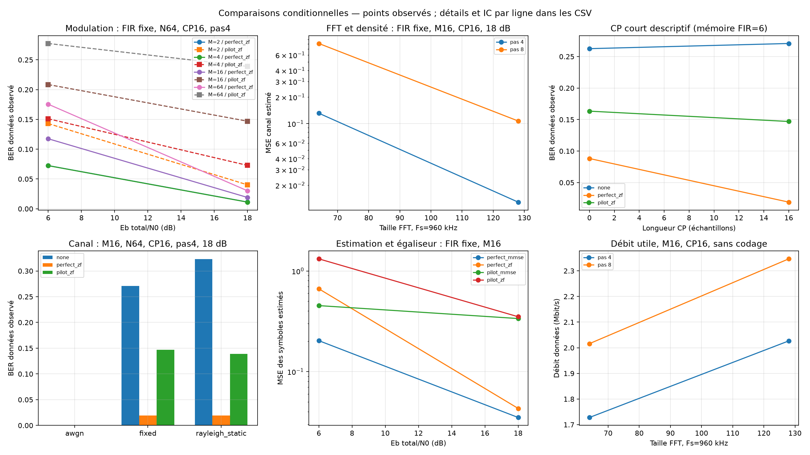

# Expérience 15 — Comparaison globale OFDM

## A. Objectif
Comparer les paramètres du système sur une grille explicite, avec témoins appariés et
bilan énergétique commun ; terminer la validation de la phase 5 avant l’image et l’interface.

## B. Théorie
Voir [protocole et interprétation](../theory/10_global_comparison.md). Eb total inclut
pilotes et CP. Le BER exact conditionnel sert de référence seulement à H parfait et CP suffisant.

## C. Hypothèses
Timing parfait, CFO nul dans cette comparaison. La correction CFO reste validée séparément
en expérience 13. Les pilotes LS sont estimés par trame, sans lissage temporel.
AWGN unitaire, FIR fixe et une réalisation Rayleigh statique issus des expériences précédentes.
ZF et MMSE utilisent leur gain de décision ; aucun epsilon d’inversion caché.

## D. Paramètres
configs/comparison.json : graine 20261017, 128 trames par essai, modulations 2/4/16/64,
Eb total/N0=6 ou 18 dB, N=64 ou 128, K=52 ou 104, CP=0 ou 16, pas pilote=4 ou 8.
Fs=960 kHz et occupation K/N=13/16 fixées, donc espacement 15 ou 7,5 kHz.
Retards FIR physiques inchangés à Fs fixe. Les cinq modes gardent les mêmes pilotes,
le même débit utile et exactement les mêmes données/bruit dans chaque essai.

## E. Implémentation
comparison.py orchestre les modules existants d’émission, canal, bruit, estimation et
réception. Cinq modes : none, perfect_zf, perfect_mmse, pilot_zf, pilot_mmse.
L’expérience 15 exécute le produit des paramètres, exporte toutes les mesures et une
coupe scorecard à N64, CP16, pas4 et 18 dB. Chaque essai conserve sa graine dérivée.

## F. Validation
Tests sur les deux FFT et les quatre modulations : budgets/compteurs communs,
ZF/MMSE appariés, retrait des IC/références quand le CP est court, répétabilité.
**128 références BER conditionnelles** passent les enveloppes simultanées au moins 99 %.
Un seul témoin perfect_zf est testé par essai, sans compter son doublon MMSE.
Les autres IC sont à 95 % par ligne, sans revendication simultanée globale.

## G. Résultats exécutés
**192 essais, 960 mesures, 4 832 256 bits distincts**, dont 128 essais à CP suffisant.
ZF/MMSE à gain compensé donnent les mêmes compteurs par porteuse/bit dans tous les essais,
pour H parfait comme H estimé. Les MSE des estimations de symboles diffèrent.

Extrait 16-QAM, N64, CP16, pas4, Eb total/N0=18 dB : **18 432 bits par ligne**.

| Canal | Mode | Erreurs | BER | MSE symboles |
|---|---|---:|---:|---:|
| Fixe | Sans correction | 4 990 | 0,270725 | 0,555335 |
| Fixe | H parfait ZF | 350 | 0,018989 | 0,043065 |
| Fixe | H parfait MMSE | 350 | 0,018989 | 0,034995 |
| Fixe | H estimé ZF | 2 709 | 0,146973 | 0,350954 |
| Fixe | H estimé MMSE | 2 709 | 0,146973 | 0,336818 |
| Rayleigh statique | H estimé ZF | 2 563 | 0,139052 | 2,486223 |
| Rayleigh statique | H estimé MMSE | 2 563 | 0,139052 | 0,486984 |

Les points sont mesurés ; les segments guident l’œil, avec seulement deux niveaux Eb/N0.
Les IC par ligne figurent dans les CSV pour éviter de surcharger les six panneaux.
Exports : global_comparison.csv (complet), global_validation.csv (références),
global_scorecard.csv (coupe) et global_comparison.json (synthèse). Les tableaux internes
sont encodés en JSON. Les zéros observés ne prouvent pas une probabilité nulle.

## H. Interprétation
Avec H connu, CP16 réduit fortement les erreurs du canal fixe face au CP absent.
Avec H estimé, le biais d’interpolation peut rester dominant. À Fs fixe, N128 rapproche
les pilotes en Hz et réduit ce biais, mais modifie aussi les ressources et durées.
La MSE MMSE peut beaucoup baisser sans amélioration BER à gain compensé : ces mesures
caractérisent des propriétés différentes, pas deux performances interchangeables.
Le débit utile augmente avec moins de pilotes ou une proportion CP plus faible ;
ce gain de débit ne garantit pas un BER acceptable.

## I. Limites
Pas de codage, diversité Rayleigh d’ensemble, suivi temporel, CFO résiduel ou timing aveugle.
CP court : résultats descriptifs, égaliseur diagonal inadapté à l’ISI.
Les densités pilotes changent l’ensemble des porteuses de données et le coût par bit.
Deux Eb/N0 donnent une comparaison discrète ; les balayages fins sont dans les expériences antérieures.
L’application pratique et l’interface web ne sont pas incluses dans cette phase.

## J. Questions d’ingénierie et réponses
1. Pourquoi garder les pilotes avec H parfait ? Pour comparer à ressources et énergie communes.
2. Pourquoi fixer Fs ? Pour conserver les retards FIR en secondes quand N change.
3. Pourquoi MMSE n’améliore-t-il pas le BER ici ? La compensation de gain retrouve les décisions scalaires ZF.
4. Pourquoi retirer les IC à CP court ? Les erreurs d’ISI dépendent du flux et invalident les hypothèses iid utilisées.
