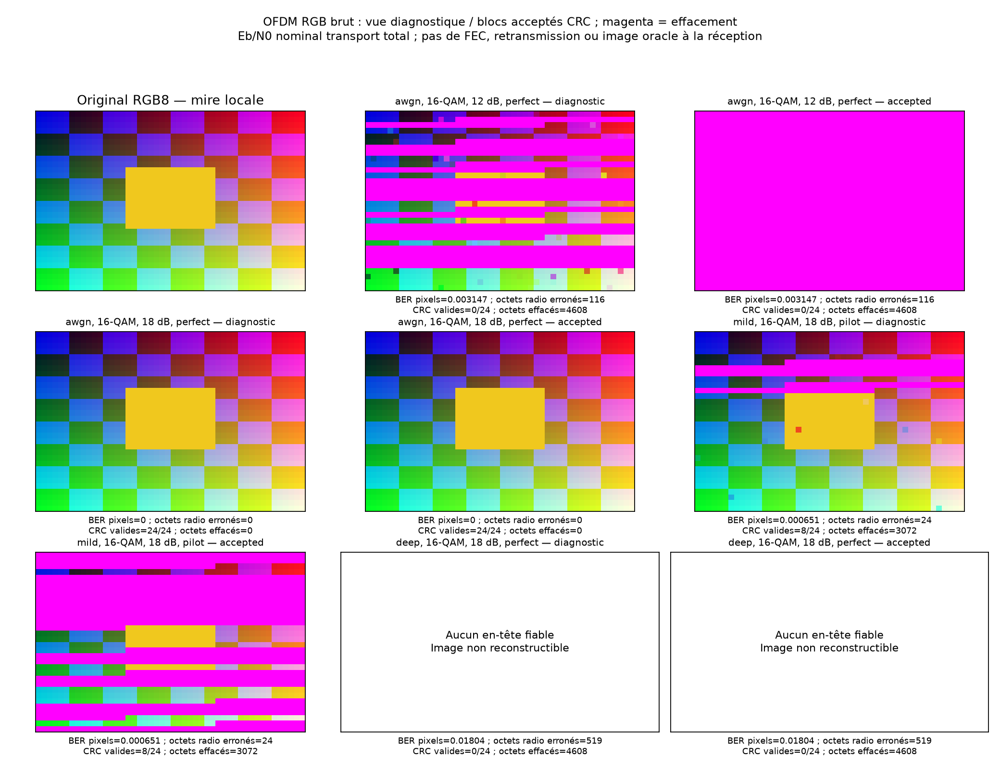

# Expérience 16 — Transmission d’une image locale

## A. Objectif
Paquétiser une image, la transmettre par OFDM, mesurer les erreurs puis reconstruire
les pixels réellement disponibles, sans utiliser l’original comme secours de réception.

## B. Théorie
[Format RGB8, trames, CRC et mesures](../theory/11_image_transport.md). CRC en-tête,
contenu et image entière ; vues diagnostique et acceptée ; aucun codage correcteur.

## C. Hypothèses
Timing et frontières connus, canal statique, CFO nul, CP16/N64/K52, pas pilote4.
H parfait ou LS interpolé par trame, ZF ; mode non corrigé conservé comme témoin.
L’original sert uniquement à l’émetteur et aux mesures, pas au décodeur.

## D. Paramètres
configs/image.json : graine 20261017, mire locale RGB48×32 (4 608 octets), S=192,
24 paquets de 228 octets. Mire créée par le projet, sans image externe ou donnée privée.
QPSK/16-QAM, Eb/N0 nominal transport total=6/12/18 dB. Trois canaux : AWGN,
FIR modéré [1, 0,25j, 0, -0,15] normalisé en énergie, FIR à creux de phase 4.
Trois modes appariés : none/perfect/pilot. Quatre modulations sont aussi vérifiées sans bruit.

## E. Implémentation
image_transport.py charge/sauve le PNG et sérialise le protocole RGB8 version1.
image_simulation.py réutilise le moteur OFDM et distingue les deux bourrages, les
compteurs radio et les effacements applicatifs. L’expérience 16 génère les exports.
Un autre PNG local est accepté avec --image ; son chemin absolu n’est pas publié.

## F. Validation
Roundtrip de pixels/dimensions ; dernier bloc, CRC contenu et global, en-tête corrompu,
troncature, réordonnancement, duplication et métadonnées contradictoires. Images de mêmes
dimensions mais CRC global distincts rejetées. Gris/RGBA testés, alpha composé sur blanc.
Sans bruit, les 12 cas (quatre modulations × trois canaux) reconstruisent exactement l’image.
Sous bruit, aucun octet accepté corrompu observé dans les 54 mesures ; ce constat n’est
pas une preuve d’absence universelle de collision CRC. Répétabilité et compteurs testés.

## G. Résultats exécutés
18 bursts bruités, trois modes appariés, **54 mesures** ; 663 552 bits de pixels
programmés au total sur les bursts et 2 363 904 décisions de transport sur les trois modes.
Les pixels sont répétés entre essais, pas présentés comme une source aléatoire nouvelle.
Chaque ligne ci-dessous porte sur **36 864 bits de pixels**, 16-QAM, H parfait :

| Canal | Eb/N0 nominal | Erreurs bits pixels | BER pixels | Octets RGB bruts erronés | Blocs acceptés / 24 | Octets effacés |
|---|---:|---:|---:|---:|---:|---:|
| AWGN | 6 dB | 2 497 | 0,067735 | 2 016 | 0 | 4 608 |
| AWGN | 12 dB | 116 | 0,003147 | 116 | 0 | 4 608 |
| AWGN | 18 dB | 0 | 0 observé | 0 | 24 | 0 |
| FIR modéré | 18 dB | 2 | 0,000054 | 2 | 22 | 384 |
| FIR à creux | 18 dB | 665 | 0,018039 | 519 | 0 | 4 608 |

À AWGN12 dB, 13 en-têtes sont rejetés et les 11 blocs à en-tête fiable ont un CRC contenu
invalide : la vue diagnostique montre ces pixels reçus, la vue acceptée est entièrement effacée.
À FIR à creux18 dB, aucun en-tête fiable n’arrive : aucune reconstruction n’est prétendue.

Magenta = remplacement après effacement, jamais « pixel reçu » implicite. CSV complet :
image_transmission.csv ; synthèse/12 cas sans bruit : image_transmission.json.
Les PNG réellement reconstruits sont dans results/images ; aucun ancien fichier n’est
gardé pour une vue non reconstructible. La mire est dans assets/test_pattern.png.

## H. Interprétation
Quelques erreurs radio peuvent invalider un bloc entier de 192 octets. Le CRC détecte,
il ne restaure pas l’image. Les pertes d’en-tête peuvent empêcher l’affichage même si
le simulateur sait mesurer les erreurs de pixels aux positions programmées.
L’écart diagnostic/accepté rend visible la politique applicative ; le BER seul ne décrit
pas l’expérience utilisateur. H parfait ne supprime pas le bruit amplifié dans un creux.

## I. Limites
Une seule mire, RGB brut non comprimé, pas de FEC/ARQ/codec ni de resynchronisation de paquets.
Eb/N0 nominal d’alphabet ; l’énergie réelle est aussi publiée car les bits ne sont pas iid.
Tous les BER sont descriptifs, sans IC binomial. Les compteurs de mesure utilisent les
positions programmées, contrairement au décodeur qui ne dispose que des trames reçues.
Le temps de calcul de Python n’est pas le débit physique de la liaison.

## J. Questions d’ingénierie et réponses
1. Pourquoi des bandes magenta ? Elles représentent des blocs perdus ou rejetés, pas du bruit ajouté visuellement.
2. Pourquoi RGB brut ? Pour séparer les erreurs de pixels des effets d’un codec comprimé.
3. Pourquoi protéger l’en-tête ? Sans dimensions/séquence fiables, les données ne peuvent pas être placées correctement.
4. Pourquoi un CRC global ? Pour vérifier l’image complète et distinguer les trames d’images différentes.
