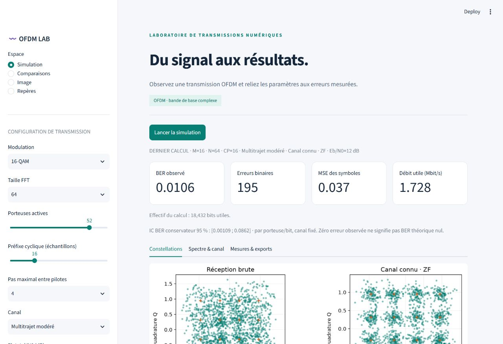
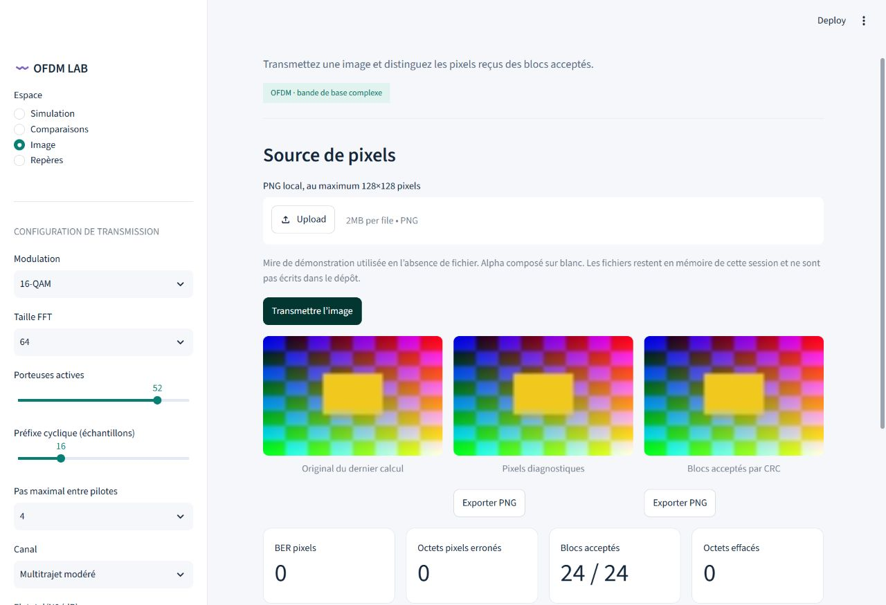

# Expérience 17 — Laboratoire Streamlit complet

## A. Objectif
Exposer les modules scientifiques validés dans une interface, sans dupliquer les
algorithmes, avec paramètres explicites, comparaisons, image et exports reproductibles.

## B. Théorie
Les conventions sont celles des expériences 1 à 16. Eb total inclut pilotes et CP.
Les courbes sont des mesures avec effectifs/graines ; aucune courbe illustrative n’est
présentée comme une simulation. Le budget image reste nominal d’alphabet.

## C. Hypothèses
Application locale Streamlit, bande de base complexe, Fs960kHz, timing parfait et CFO nul.
Le Rayleigh est une réalisation statique. Les références BER sont conditionnelles à H ;
aucun IC binomial avec CP court ou image déterministe. Pas de FEC, ARQ, Doppler ni RF physique.

## D. Paramètres
Défaut : 16-QAM, FFT64, K52, CP16, pas pilote4, canal multitrajet modéré, H connu/ZF,
Eb total/N0=12dB, 128 trames, graine 20261018. FFT32..256, quatre modulations, CP0..N,
quatre modèles de canal, trois connaissances H et égalisation optionnelle.
Limites interactives documentées dans [le guide de lancement](../../app/README.md).

## E. Implémentation
app/streamlit_app.py contient présentation et navigation. laboratory.py valide les
réglages, orchestre comparaison/image et produit des exports en mémoire. comparison.py
peut renvoyer une trace bornée optionnelle sans modifier ses résultats historiques.
PNG chargé depuis des octets en mémoire ; aucune image personnelle écrite côté dépôt.
Les snapshots séparent paramètres actuels et réellement calculés, y compris niveaux du
balayage. Un ancien snapshot de session est migré à partir des valeurs mesurées.

## F. Validation
342 tests avec l’extra app installé, dont quatre parcours Streamlit AppTest.
Équivalence de la trace avec le moteur existant, canal fixé sur balayage et graines
exportées ; validation des limites et aller-retour PNG en mémoire. Navigation, historique,
image et états périmés testés. Contrôle navigateur et téléchargements complètent AppTest.
Expérience 17 : six vérifications des services et exports reproductibles.

## G. Résultats exécutés
Le calcul initial affiche 195 erreurs sur 18 432 bits utiles, BER 0,0105794,
MSE symboles ZF 0,0370041 et débit utile 1,728Mbit/s. Le JSON et le CSV téléchargés
conservent M16/N64/CP16, Eb12dB et graine 20261018 : les mesures ne sont pas réétiquetées
après modification de la barre latérale. L’essai image de service à AWGN30dB restitue
la mire avec CRC global valide.

Exports de vérification : interactive_lab.json, interactive_sweep.csv et
interactive_reproducibility.json dans results/. Les captures d’interface documentent
le rendu, sans constituer de nouvelles mesures radio.

## H. Interprétation
L’interface rend les compromis visibles et conserve la provenance des résultats.
ZF/MMSE peuvent donner les mêmes décisions et des MSE différentes. Le mode image
sépare défaut radio, CRC et effacement applicatif. Les graphiques téléchargés conservent
axes/unités ; les données complètes et paramètres restent disponibles séparément.

## I. Limites
Pas d’hébergement public configuré, d’authentification ou de test de charge multiutilisateur.
La session est temporaire : conserver par téléchargement avant fermeture. La DSP et les
nuages sont bornés pour l’affichage. AppTest est complété par une vérification visuelle,
sans prétendre couvrir tous les formats d’écran ou navigateurs.

## J. Questions d’ingénierie et réponses
1. Pourquoi un bouton explicite de calcul ? Pour éviter des simulations lourdes à chaque réglage.
2. Pourquoi conserver les paramètres exécutés ? Pour ne pas attribuer une mesure à une configuration non calculée.
3. Pourquoi ne pas réécrire le moteur dans l’interface ? Pour partager les mêmes conventions et validations.
4. Le logiciel est-il hébergé en ligne ? Cette livraison se lance localement dans le navigateur.

## Référence d’interface
[Documentation officielle Streamlit AppTest](https://docs.streamlit.io/develop/api-reference/app-testing)
utilisée pour les tests de parcours ; les validations radio appartiennent aux modules du projet.
